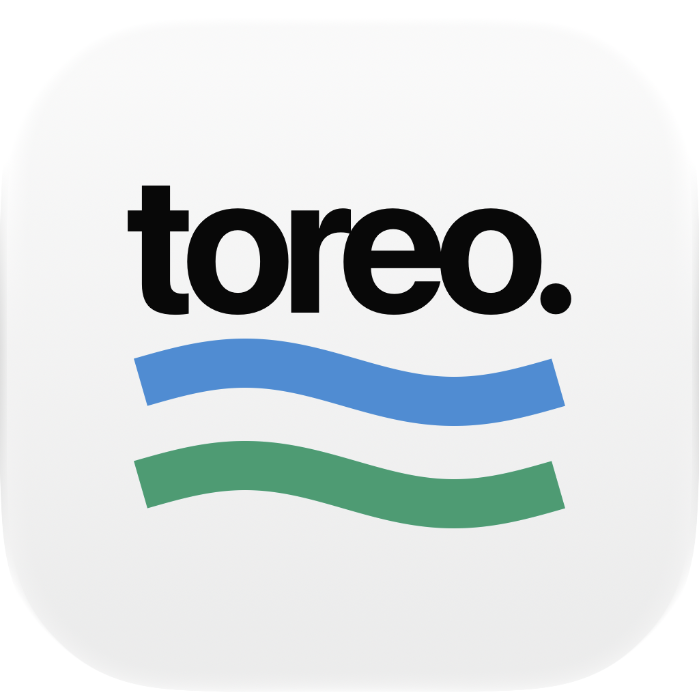
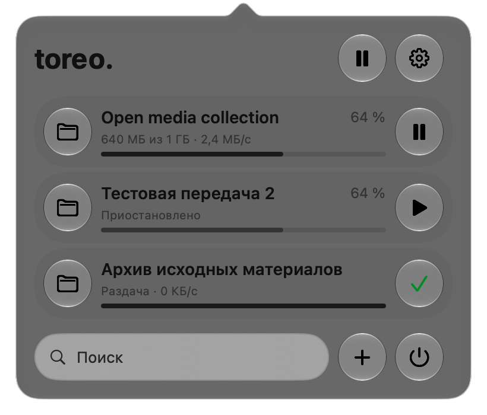

<p align="center">
  <picture>
    <source media="(prefers-color-scheme: dark)" srcset="docs/images/icon-dark.png">
    
  </picture>
</p>

<h1 align="center">toreo.</h1>
<p align="center"><strong>English</strong> · <a href="README.uk.md">Українська</a> · <a href="README.ru.md">Русский</a></p>
<p align="center">English · [Українська](README.uk.md) · [Русский](README.ru.md)</p>

A native menu bar torrent client for Apple Silicon. Add a torrent or magnet link, follow your downloads, and open the finished files from one compact Liquid Glass panel.

<p align="center">
  <a href="https://github.com/morphinephotographer/toreo./releases/download/v0.3.5-build11/Toreo-0.3.5-build11-macOS-arm64.dmg"><strong>Download DMG</strong></a>
  &nbsp; · &nbsp;
  <a href="https://github.com/morphinephotographer/toreo./releases/download/v0.3.5-build11/Toreo-0.3.5-build11-macOS-arm64.zip"><strong>Download ZIP</strong></a>
</p>
<p align="center"><sub>Apple Silicon · macOS 26 or later · English, Українська, Русский</sub></p>

<picture>
  <source media="(prefers-color-scheme: dark)" srcset="docs/images/transfers-dark.png">
  
</picture>

## Made for your menu bar

- Two waves animate while downloading and become an equals sign when paused.
- Switch to horizontal download and upload speeds in Settings.
- Add .torrent files, magnet links, or drag a file onto the panel.
- Choose blue and mint, dark, monochrome, and previous Dock icon styles.
- Automatically import new torrent files and restore your transfers after restarting.
- Search transfers and torrent files, choose individual files, and move downloads to the Trash.

## Install

1. Download the DMG and drag **toreo..app** to **Applications**, or unzip the ZIP and move the app there.
2. Open the app and use its menu bar icon. Settings contains the language, Dock icon, and menu bar display options.

The download is ad-hoc signed and is not notarized by Apple. macOS may ask you to approve the app in System Settings → Privacy & Security.

## Build from source

Requires Xcode with Swift 6.2 or later, CMake, Git, and an Apple Silicon Mac. The build script fetches pinned Transmission sources and submodules.

```sh
git clone https://github.com/morphinephotographer/toreo..git
cd toreo.
./build.sh
```

## Local by design

Transfer state is stored locally in `~/Library/Application Support/Rill/Engine`. toreo. has no account or analytics service. BitTorrent connects directly to trackers and peers.

## License

Original toreo. code and artwork are MIT licensed. The app includes Transmission and is distributed under GPLv3. See [LICENSE](LICENSE) and [third-party notices](THIRD_PARTY_NOTICES.md).

---

Built by MORPHINE.
