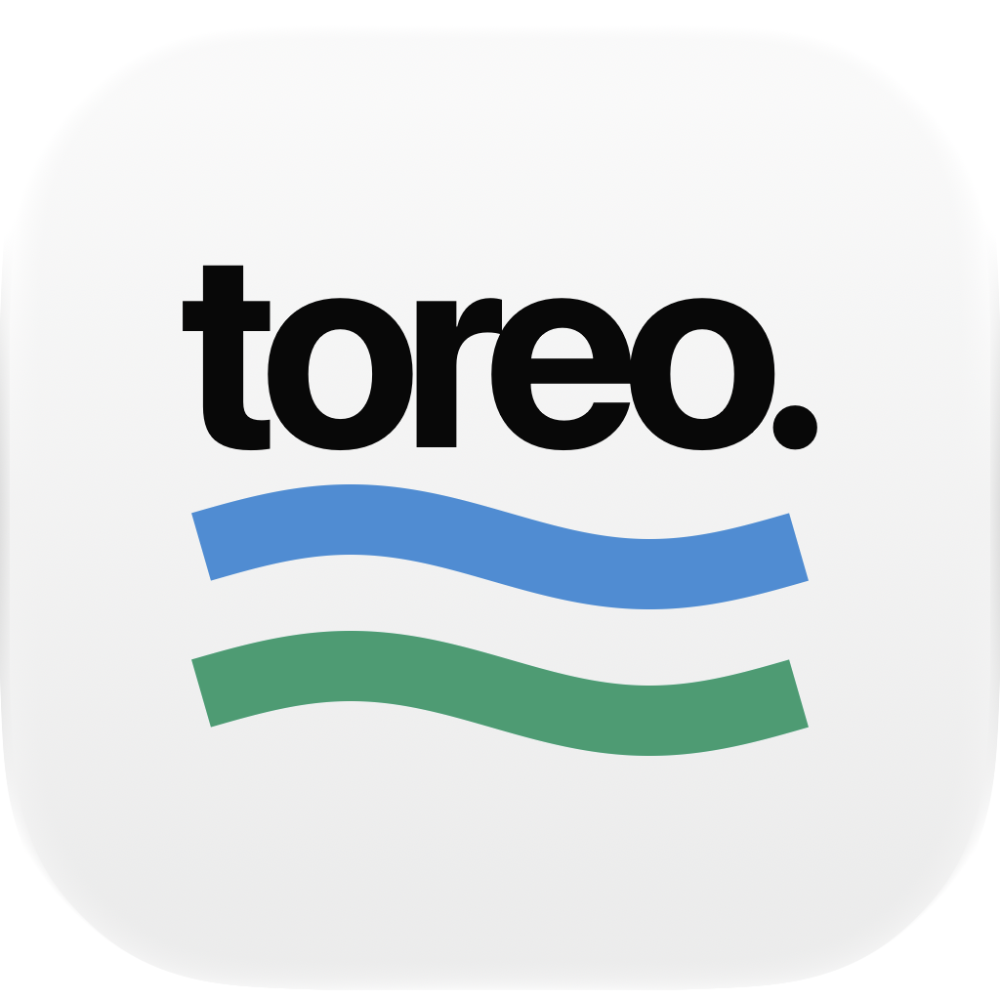
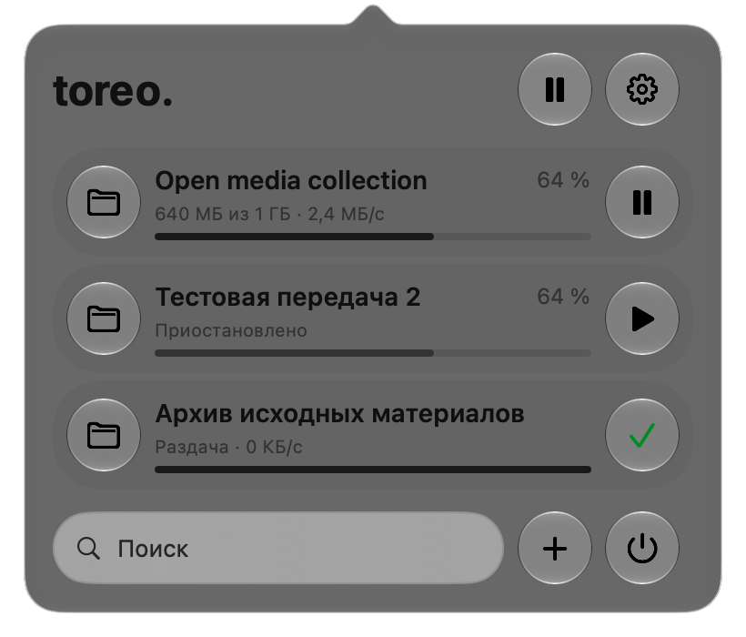

<p align="center">
  <picture>
    <source media="(prefers-color-scheme: dark)" srcset="docs/images/icon-dark.png">
    
  </picture>
</p>

<h1 align="center">toreo.</h1>
<p align="center">Загрузки — в строке меню.</p>
<p align="center">[English](README.md) · [Українська](README.uk.md) · Русский</p>

Нативный торрент-клиент для Apple Silicon. Добавляйте торренты и magnet-ссылки, следите за загрузками и открывайте готовые файлы в компактной панели Liquid Glass.

<p align="center">
  <a href="https://github.com/morphinephotographer/toreo./releases/download/v0.3.5-build11/Toreo-0.3.5-build11-macOS-arm64.dmg"><strong>Скачать DMG</strong></a>
  &nbsp; · &nbsp;
  <a href="https://github.com/morphinephotographer/toreo./releases/download/v0.3.5-build11/Toreo-0.3.5-build11-macOS-arm64.zip"><strong>Скачать ZIP</strong></a>
</p>
<p align="center"><sub>Apple Silicon · macOS 26 или новее · English, Українська, Русский</sub></p>

<picture>
  <source media="(prefers-color-scheme: dark)" srcset="docs/images/transfers-dark.png">
  
</picture>

## Всё рядом, в строке меню

- Две волны движутся при скачивании и выравниваются в знак равенства на паузе.
- В настройках можно включить горизонтальное отображение скоростей загрузки и отдачи.
- Добавляйте .torrent, magnet-ссылки или перетаскивайте файл на панель.
- Выбирайте сине-мятную, тёмную, чёрно-белую или прежние иконки Dock.
- Новые торрент-файлы импортируются автоматически, передачи восстанавливаются после перезапуска.
- Ищите передачи и торрент-файлы, выбирайте отдельные файлы и перемещайте загрузки в Корзину.

## Установка

1. Скачайте DMG и перетащите **toreo..app** в **Программы** либо распакуйте ZIP и переместите приложение туда.
2. Откройте приложение и нажмите его значок в строке меню. Язык, иконка Dock и вид строки меню меняются в настройках.

Сборка подписана локально и не нотарифицирована Apple. macOS может попросить разрешить запуск в Системных настройках → Конфиденциальность и безопасность.

## Сборка из исходников

Нужны Xcode со Swift 6.2 или новее, CMake, Git и Mac с Apple Silicon. Сценарий скачивает закреплённую версию Transmission и подмодули.

```sh
git clone https://github.com/morphinephotographer/toreo..git
cd toreo.
./build.sh
```

## Локальное хранение

Состояние передач хранится в `~/Library/Application Support/Rill/Engine`. В toreo. нет аккаунтов и сервиса аналитики. BitTorrent подключается напрямую к трекерам и пирам.

## Лицензия

Собственный код и графика toreo. доступны по MIT. Приложение включает Transmission и распространяется по GPLv3. Подробнее в [LICENSE](LICENSE) и [перечне сторонних компонентов](THIRD_PARTY_NOTICES.md).

---

Создано MORPHINE.
