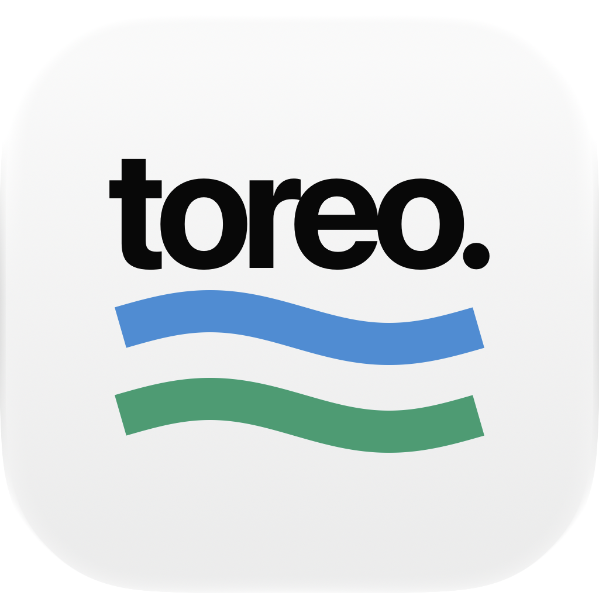
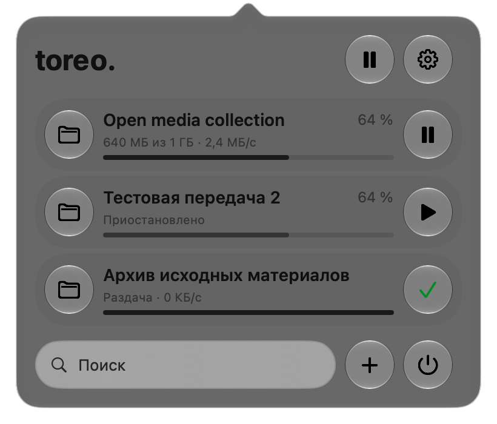

<p align="center">
  <picture>
    <source media="(prefers-color-scheme: dark)" srcset="docs/images/icon-dark.png">
    
  </picture>
</p>

<h1 align="center">toreo.</h1>
<p align="center"><a href="README.md">English</a> · <strong>Українська</strong> · <a href="README.ru.md">Русский</a></p>
<p align="center">[English](README.md) · Українська · [Русский](README.ru.md)</p>

Нативний торрент-клієнт для Apple Silicon. Додавайте торренти й magnet-посилання, стежте за завантаженнями та відкривайте готові файли в компактній панелі Liquid Glass.

<p align="center">
  <a href="https://github.com/morphinephotographer/toreo./releases/download/v0.3.5-build11/Toreo-0.3.5-build11-macOS-arm64.dmg"><strong>Завантажити DMG</strong></a>
  &nbsp; · &nbsp;
  <a href="https://github.com/morphinephotographer/toreo./releases/download/v0.3.5-build11/Toreo-0.3.5-build11-macOS-arm64.zip"><strong>Завантажити ZIP</strong></a>
</p>
<p align="center"><sub>Apple Silicon · macOS 26 або новіша · English, Українська, Русский</sub></p>

<picture>
  <source media="(prefers-color-scheme: dark)" srcset="docs/images/transfers-dark.png">
  
</picture>

## Усе поруч, у рядку меню

- Дві хвилі рухаються під час завантаження й вирівнюються у знак рівності на паузі.
- У налаштуваннях можна ввімкнути горизонтальне відображення швидкостей завантаження й віддачі.
- Додавайте .torrent, magnet-посилання або перетягуйте файл на панель.
- Обирайте синьо-м’ятну, темну, чорно-білу або попередні іконки Dock.
- Нові торрент-файли імпортуються автоматично, передачі відновлюються після перезапуску.
- Шукайте передачі та торрент-файли, обирайте окремі файли й переміщуйте завантаження до Смітника.

## Встановлення

1. Завантажте DMG і перетягніть **toreo..app** до **Програм** або розпакуйте ZIP та перемістіть туди застосунок.
2. Відкрийте застосунок і натисніть його значок у рядку меню. Мова, іконка Dock і вигляд рядка меню змінюються в налаштуваннях.

Збірка має локальний підпис і не нотаризована Apple. macOS може попросити дозволити запуск у Системних параметрах → Приватність і безпека.

## Зібрати з вихідного коду

Потрібні Xcode зі Swift 6.2 або новішим, CMake, Git і Mac з Apple Silicon. Сценарій завантажує зафіксовану версію Transmission та підмодулі.

```sh
git clone https://github.com/morphinephotographer/toreo..git
cd toreo.
./build.sh
```

## Локальне зберігання

Стан передач зберігається в `~/Library/Application Support/Rill/Engine`. У toreo. немає облікових записів і сервісу аналітики. BitTorrent підключається безпосередньо до трекерів і пірів.

## Ліцензія

Власний код та графіка toreo. доступні за MIT. Застосунок містить Transmission і поширюється за GPLv3. Докладніше в [LICENSE](LICENSE) та [переліку сторонніх компонентів](THIRD_PARTY_NOTICES.md).

---

Створено MORPHINE.
